# Venture Wolf Financial Engine Architecture

## 1. Executive Overview

The Venture Wolf Financial Engine is a robust, end-to-end forecasting system designed to generate bespoke, institutional-grade financial models for founders in seconds. The architecture operates through a seamless 5-phase pipeline:

1. **Authentication & Data Collection:** The React Native frontend collects the startup's core profile (Company Name, Archetype, Description) via the `ForecastForm`.
2. **AI Analysis (The Brain):** The Express.js backend receives this payload and prompts the Gemini AI, which assumes the persona of a cynical Indian VC. It enforces strict macroeconomic guardrails (tax rates, inflation, EPF) to generate a realistic set of `Worst`, `Base`, and `Best` case assumptions.
3. **Excel Injection:** Using `exceljs`, the generated assumptions are mapped and directly injected into the corresponding master `.xlsx` template (SaaS, Manufacturing, or Services).
4. **Data Extraction:** The engine triggers formula recalculations inside the workbook and programmatically extracts a structured 14-metric PAT waterfall summary directly from the Excel grid.
5. **Storage & UI Render:** The dynamically generated `.xlsx` workbook is uploaded to a secure Supabase Storage bucket. The public download URL and the JSON-extracted metrics are piped back to the React Native app, displaying a rich `ProjectionsDashboard`.

---

## 2. System Sequence Diagram

```mermaid
sequenceDiagram
    autonumber
    actor Founder
    participant Mobile as React Native App
    participant API as Express API Router
    participant Gemini as Gemini AI (VC Persona)
    participant ExcelJS as ExcelJS Engine
    participant Supabase as Supabase Storage Bucket

    Founder->>Mobile: Submits Profile (Name, Archetype, Description)
    Mobile->>API: POST /api/finance/forecast
    
    rect rgb(30, 41, 59)
    note right of API: Phase 1: AI Guardrail Processing
    API->>Gemini: Request Market Assumptions (Strict Zod Schema)
    Gemini-->>API: Return valid JSON (Worst, Base, Best Cases)
    end
    
    rect rgb(30, 41, 59)
    note right of API: Phase 2: Matrix Injection
    API->>ExcelJS: Load template_[archetype].xlsx
    ExcelJS->>ExcelJS: Inject AI JSON into ASSUMPTIONS sheet
    ExcelJS->>ExcelJS: Recalculate workbook formulas
    ExcelJS->>ExcelJS: Extract 14 metrics from YEARLY_SUMMARY sheet
    end
    
    rect rgb(30, 41, 59)
    note right of API: Phase 3: Storage & Delivery
    API->>Supabase: Upload updated .xlsx buffer
    Supabase-->>API: Return public download URL
    end
    
    API-->>Mobile: 200 OK { summaryData, downloadUrl }
    Mobile-->>Founder: Renders ProjectionsDashboard
```



---

## 3. Data Payload Specifications

### 3.1 Incoming Request (Mobile ➡️ API)
The frontend transmits a lightweight payload representing the startup's profile.

```json
{
  "companyName": "Acme Corp",
  "archetype": "SAAS", 
  "description": "B2B AI analytics platform targeting mid-market fintechs in Mumbai."
}
```
*Note: Valid `archetype` values are limited to `SAAS`, `MANUFACTURING`, or `SERVICES`.*

### 3.2 Outgoing Response (API ➡️ Mobile)
The API responds with both the raw AI assumptions (for debugging/audit trails), the calculated data grid, and the secure file URL.

```json
{
  "success": true,
  "data": {
    "assumptionsGenerated": {
      "Worst": { /* ... */ },
      "Base": { /* ... */ },
      "Best": { /* ... */ }
    },
    "projections": {
      "worstCase": {
        "1. Total Revenue": [100000, 120000, 140000, 180000, 250000],
        "5. EBITDA": [-10000, 5000, 15000, 30000, 80000],
        "11. PAT": [-12000, 2000, 10000, 22000, 60000],
        "...": "..." // (Total of 14 core metrics x 5 Years)
      },
      "baseCase": { /* ... */ },
      "bestCase": { /* ... */ }
    },
    "downloadUrl": "https://[SUPABASE_PROJECT].supabase.co/storage/v1/object/public/financial_models/Acme_Corp_Forecast_17154212.xlsx"
  }
}
```
